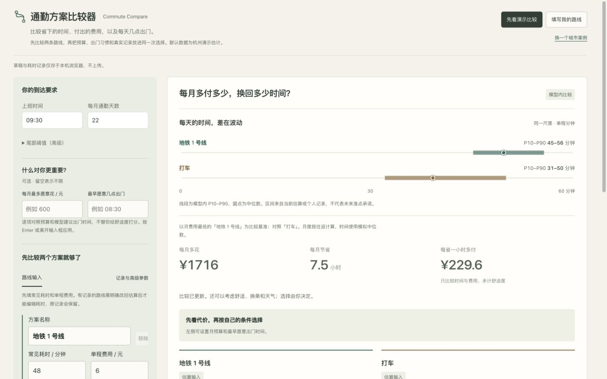

# Commute Compare

Final display/export polish verified locally; calculation and persistence contracts retained. Unpublished. [Changes and checks](docs/FINAL-DETAIL-20261103.md).

Independent task-flow rechecks passed; changes remain local and unpublished. [Review scope and untested limits](docs/INDEPENDENT-REVIEW-20261103.md).

2026-11-03 local review fixes: sibling tools open in new tabs; unfinished text is restored separately from confirmed results. No push, merge or publication. [Behavior and checks](docs/DRAFT-RECOVERY-20261103.md).

2026-11-03 · 本地迭代 / local only, not published: Active record medians, ranges, N and archived estimates agree across UI, summary and JSON. Changed conditions require reconfirmation, with sparse-tail uncertainty retained. A download recovery link belongs to one confirmed snapshot and disappears when it is stale. Tests (19), type checks and build passed; the actual JSON file contains median 39, N=3 and no justified target-tail departure time. [验收记录](docs/TASK-CLARITY-20261103.md)。

Visual refresh approved after user review, 2026-11-02: [design, references and before/after screenshots](docs/VISUAL-CRAFT-20261102.md). Existing product behavior is preserved; the merge commit and Pages workflow record publication.


[中文](README.md) · [Project index](https://github.com/AndyZhang666666/AndyZhang666666/blob/main/PROJECTS.en.md) · [Live demo](https://andyzhang666666.github.io/commute-compare/)

Does the route with a shorter typical trip let you leave later?

Approved release, 2026-11-02: Optional budget and earliest-departure constraints, trial-record previews and reconfirmed decisions now share one workspace. Model checks, a static build and integrated browser review are complete; this release ships with the portfolio. [Design and boundaries](docs/PERSONAL-ROUTE-20261101.md).



## Product decisions

- Compare duration distributions, cost and tail risk together.
- Label estimates separately from personal observations and expose sparse samples.
- Preview threshold changes before committing; adding a route must not change another route’s samples.

## Walkthrough

1. Start with typical duration estimates or paste personal door-to-door records.
2. Compare cost, time and lateness risk alongside each route’s data source.
3. Preview and confirm a departure threshold, then export its assumptions.

## Run mode and limits

Browser calculations without maps or live traffic. Personal records use empirical resampling; estimated routes use explicit distribution assumptions. Neither guarantees future punctuality.

## Develop locally

```sh
npm ci
npm run dev
```

Open `http://localhost:3000/commute-compare/`. The repository base path is part of the URL.

## Lightweight checks

```sh
npm run check
npm run build
```

These commands are provided for reproduction; this documentation update did not run a new model benchmark.

## Documentation

- [Product scope](docs/PRD.md)
- [Validation records](docs/VALIDATION.md)
- [Implementation details and original records, Chinese](README.md)

Use the repository’s existing licence and notices. This update does not change usage rights.

## Personal inputs and portable results · 2026-11-01

This update adds personal inputs and a portable result, with the reviewed implementation integrated through a release branch. Compare personal routes, calibrate one route with records, and save a reason with an independent decision snapshot. Estimates and recorded observations remain distinct. Changed inputs require confirmation before exporting a current choice.
