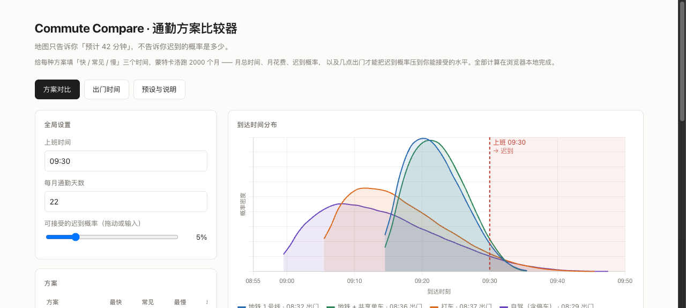
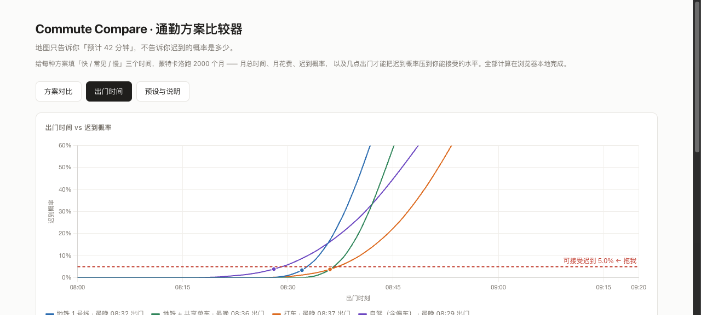

# Commute Compare · 通勤方案比较器

比较通勤时间、费用和出门时刻。先少填一点，用自己的记录逐步校准。

2026-10-25：数字输入可确认/取消，留空不变零；图上拖动只预览，松开才提交，阈值与表单/草稿统一为1%–20%。旧草稿损坏时不自动覆盖，手动出门时刻和方案ID均校验。采样改为绑定路线身份，删除或换序不会改变其他路线的结果；费用相同和并列最优单独表述。[本轮验证](docs/VALIDATION.md)与[产品判断](docs/PRD.md)记录了边界和复跑方式。

2026-10-24：默认两条估算路线；新增快速估算、实际耗时记录、按方案显示来源与样本量、观测比例 Wilson 区间、本地草稿及决策 JSON 导出。原高级输入与四城预设保留。记录使用经验重采样，不把实测再拟合成 PERT。

快速估算修改常见耗时时，默认用 `最快 = floor(常见 × 0.8)`、`最慢 = ceil(常见 × 1.8)`，这是公开假设，不是交通测量。原预设未编辑时保留原三点值。记录应用后直接从 3–300 个用户数字采样，内容只存本机。样本不足会提示：例如 3 条记录不能细分 5% 尾部。

**结果边界：** 0 次观测迟到不代表真实风险为 0；Wilson 区间只描述独立同分布假设下的观测比例，且出门时刻从同批记录选择，不构成独立验证。月度估算假设返程同分布、每天独立，不查实时交通、不保证未来准点率。详见 [CHANGELOG.md](CHANGELOG.md)。

**在线 Demo**：https://andyzhang666666.github.io/commute-compare/



## 它解决什么问题

地图 App 的路线推荐只给一个数——「预计 42 分钟」。但通勤决策真正需要的是分布：地铁 40 分钟几乎不变，打车中位 30 分钟但堵车时 70 分钟。**均值更低的方案，迟到概率可能更高。** 一个只看均值的人会选打车，然后每个月迟到两三次。

这个工具把「预计时间」变成「时间分布」，把「哪个快」变成「哪个更稳、值不值那个钱」。输入几种通勤方案，每种给「快 / 常见 / 慢」三个时间和一个花费，它用蒙特卡洛模拟 2000 个月，告诉你每种方案的月总时间、月总花费、迟到概率，以及**几点出门才能把迟到概率压到你能接受的水平**。

它不局限于某个城市。杭州金沙湖 → 西湖区只是默认加载的预设之一（另有北京、上海、深圳），任何人输入自己的方案就能用。不接任何地图 API，不查真实路况，全部计算在浏览器本地完成。

## 怎么用

1. **输入**：先在「快速估算」填常见耗时与单程费用；或在「记录校准」粘贴实际门到门分钟数；熟悉分布后再使用高级三点参数。2–6 个方案可增删。
2. **看图**：右侧到达时间分布图里，红线右边的面积就是迟到概率；下面的指标表标出「最省时间 / 最稳 / 最便宜」三个冠军。
3. **拖阈值**：切到「出门时间」tab，按住红线预览，松开提交1%–20%的整百分点；也可用数字框。交点是当前输入分布下的最晚出门时间，不是现实准点承诺。



## 核心逻辑

**估算模式为什么使用 PERT。** 这是一个有上下界的近似，使用固定 λ=4。形状由三点决定，不一定右偏；未用真实路况证明优于其他分布。三角分布也是可选近似，具体尾部需用记录校准。记录模式不使用 PERT。

```
mean = (min + 4·mode + max) / 6
α = 1 + 4·(mode − min) / (max − min)
β = 1 + 4·(max − mode) / (max − min)
样本 = min + (max − min) · Beta(α, β)
```

**迟到概率 = 到达分布在上班时间右侧的面积。** 设出门时刻 `d`、上班时刻 `w`，迟到 ⟺ 耗时 > `w − d`，所以迟到概率 = 1 − F(w − d)。

**建议出门时间 = 上班时间 − (1 − 阈值) 样本分位数，再向前取整。** 仅在当前输入分布内约束迟到比例，不保证现实风险。取排序样本的保守次序统计量而非插值，避免离散实测记录的分位数落在缺乏观测的中间位置。阈值取 0% 时按样本最慢值计算。

**蒙特卡洛**：每个方案独立抽 2000 个月 × 22 天 × 往返 2 次 = 88,000 个单程样本，排序后取分位数得到月总时间的 P10/P50/P90；迟到概率用二分在排序样本上直接数。月时间和月花费都按往返算，两者口径一致。

## 校验

`npm run verify` 用 Node 直接跑 `src/lib/` 里和页面同一份代码，产物写入 `results/`。固定种子 `20260914`，重跑数字一致。

当前模型版本`stable-route-seed-v2-2026-10-25`：每个路线ID绑定固定随机流；四城完整预设沿用原序号的随机流，保持下表数值可复现。自定义路线使用ID哈希，增删其他路线不重新播种。本轮重新验证的产物只更新生成日期，完整预设数值不变。固定种子仅便于复现，不能证明真实预测准确。

`npm run check`保留原分布、README、经验记录回归，并新增6组边界；`scripts/test-browser.mjs`验证输入确认、真实拖动、草稿/记录、预设与JSON产物，可用`TEST_URL`复验线上。全部计算在本地，测试不调用地图或模型。

**分布正确性**（`results/distribution-check.json`）：PERT(30, 40, 80) 采样 100,000 次，样本均值 44.982，理论值 45，误差 0.018（要求 < 0.3）；P50 = 43.82，落在 42–44 之间且小于均值，右偏成立；样本范围 [30.03, 78.06] 落在 [30, 80] 内。另两组 PERT(42,48,65)、PERT(28,35,70) 的均值误差分别为 0.011 和 0.004。

**边界情况**：min = mode = max = 45 时 10,000 次采样恒为 45；迟到阈值设为 0% 时建议出门时间等于「上班时间 − 最慢样本」；在建议出门时间出门迟到概率 ≤ 5%，再晚 1 分钟就 > 5%——建议时间确实是「最晚」。

**四个预设案例**（`results/presets-summary.json`，N = 5000 个月，上班 09:30、每月 22 天、阈值 5%）：

| 城市 | 方案 | 快/常见/慢 | 月时间 P50 | 月花费 | 建议出门 | 迟到概率 | 稳定性 (P90−P10) |
|---|---|---|---|---|---|---|---|
| 杭州 金沙湖→西湖区 | 地铁 1 号线 💰 | 42/48/65 | 36.54h | ¥264 | 08:32 | 3.53% | 10.89 分钟 |
| | 地铁 + 共享单车 ⚡ | 38/45/60 | 33.97h | ¥330 | 08:36 | 3.79% | 10.76 分钟 |
| | 打车 ⏱ | 28/35/70 | 29.07h | ¥1980 | 08:37 | 4.99% | 18.56 分钟 |
| | 自驾（含停车） | 30/40/80 | 32.95h | ¥1672 | 08:29 | 4.97% | 22.76 分钟 |
| 北京 回龙观→中关村 | 地铁 13 号线 ⚡ | 40/50/75 | 38.52h | ¥220 | 08:26 | 4.85% | 16.85 分钟 |
| | 公交 💰 | 45/60/100 | 47.03h | ¥88 | 08:08 | 4.98% | 26.27 分钟 |
| | 打车 ⏱ | 30/45/95 | 37.27h | ¥2420 | 08:18 | 4.91% | 30.21 分钟 |
| | 自驾（含停车） | 30/45/100 | 37.86h | ¥2200 | 08:15 | 4.43% | 32.22 分钟 |
| 上海 张江→陆家嘴 | 地铁 2 号线 ⚡💰 | 30/38/55 | 28.95h | ¥220 | 08:42 | 4.15% | 12.22 分钟 |
| | 打车 ⏱ | 25/35/70 | 28.72h | ¥2200 | 08:36 | 4.68% | 20.85 分钟 |
| | 自驾（含停车） | 25/38/75 | 30.78h | ¥2640 | 08:31 | 4.24% | 23.69 分钟 |
| 深圳 龙华→南山科技园 | 地铁 4 + 1 号线 ⚡💰 | 50/58/80 | 44.23h | ¥308 | 08:19 | 3.49% | 14.25 分钟 |
| | 打车 ⏱ | 35/45/90 | 37.27h | ¥2640 | 08:21 | 4.54% | 24.74 分钟 |
| | 自驾（含停车） | 35/48/95 | 39.34h | ¥1980 | 08:16 | 4.26% | 27.6 分钟 |

⏱ 最省时间 · ⚡ 最稳 · 💰 最便宜。四个城市里「最省时间」和「最稳」没有一次落在同一个方案上。

最能说明问题的是北京：打车单程均值 50.82 分钟，只比地铁 13 号线的 52.52 分钟快 2 分钟，但为了同样 5% 的准点率，打车要 08:18 出门，地铁 08:26——**均值快 2 分钟，出门反而要早 8 分钟**，每月还多花 ¥2200。上海更极端：打车和地铁 2 号线的均值几乎一样（39.18 vs 39.49），但打车的 P90−P10 是 20.85 分钟，地铁只有 12.22，所以打车要早 6 分钟出门。均值上占的便宜被长尾吃掉了。

`npm run verify-readme` 会逐条比对 README 里的数字和 `results/` 是否一致，CI 里构建前跑。

## 一个对地图产品的建议

路线推荐应该给「到达时间分布 + 准点概率」，而不只是一个预计值。同样的均值下，方差小的方案对通勤者价值更高；「08:35 出门，95% 概率 09:30 前到」比「预计 42 分钟」更接近用户真正要做的决定。再进一步，告诉用户这条路线的波动主要来自哪里（换乘排队、高速拥堵、找车位），用户才知道该不该为「稳」多花钱。

## 已知局限

- 时间分布由用户估计，不是实测；接入真实历史通勤数据是自然的下一步
- 假设每天独立同分布，未建模「周一更堵」「雨天更慢」这类系统性差异，所以月总时间的 P90 偏乐观
- 花费不含时间价值折算——省下的 7 小时要不要用 ¥1716 换，工具不给答案
- 预设案例的所有数值都是经验估计，非实测

## 本地运行

```bash
npm ci
npm run dev        # 访问 http://localhost:3000/commute-compare/（basePath 是仓库名，根路径 404）
npm run verify     # 跑校验，产物写入 results/
npm run build      # 静态导出到 out/，自动写 .nojekyll
npm run preview    # 以 /commute-compare/ 前缀预览 out/，路径与 GitHub Pages 一致
```

技术栈：Next.js 15 · React 19 · TypeScript · Chart.js 4 · CSS Modules。无服务端、无 API。

## License

MIT
