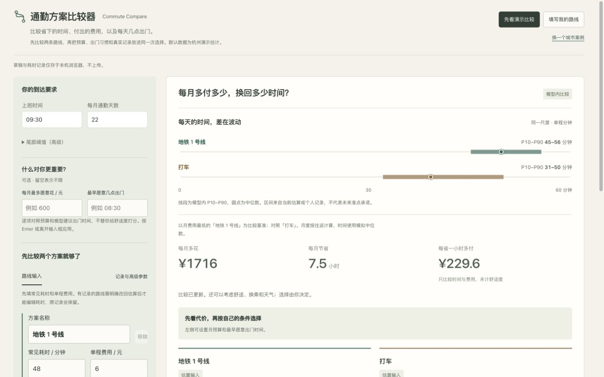

# 通勤比较器 · 视觉候选

2026-11-02。分支 `design/demo-craft-20261102`，从已批准发布基线继续迭代。**新视觉尚未合并或发布**；以实际审阅结论决定是否采用。实现提交 `964c875`。

个人时刻表：同尺度路线区间移到费用取舍之前，路线颜色对应输入、区间与选择。左侧是一块连续条件工作纸，右侧是一份连续比较结果，减少重复框卡。只移动已有TimeRanges呈现位置，计算和持久化不变。

共同使用官网的象牙纸、低饱和表面和系统中文字体；控件高度、信息密度及反馈按工具场景调整。SVG小标记为本项目自绘，不引入图标包、付费服务、图库依赖或未知安装脚本。纸张投影只出现在海报实物，数据工作区保持平面。

## 真实参考

[Citymapper 官方指南：路线身份、时间与费用并列，以及真实运输界面的信息节奏；这里不显示虚构地图或实时路况。](https://content.citymapper.com/news/2958/a-guide-to-using-citymapper)

参考图 `libfile_836fd23c6af48191881eaf1815f01c88` 已按Library流程传至本地并在本会话打开像素。它是使用真实素材、用实际产品截图参考设计的文字建议，并非具体版式；没有照猜配色或复制专属资产。

## 检查结果

14项边界/决策检查、原分布与README数字回归、TypeScript与生产静态构建通过。手机提交预算/最早出门时间、解释无可行路线、带理由选择并复制、改耗时后旧选择过期、无效时钟阻断、单条记录先预览再积累、刷新恢复通过。

1440×900、768×1024、390×844 实际浏览器检查均无页面级横向溢出；手机输入、键盘Enter、对应确认/取消和恢复路径已实际操作。减少动态效果的CSS保留并静态检查；未切换操作系统设置，未做物理手机或读屏器测试。自动检查不代表真实用户完成率或业务效果。

视觉检查修正了旧移动端样式的影响：Eval五维目录的旧跨列规则、Bundle导航换行；这些修复不改变业务功能。其余项目不是使用同一组面板换颜色，而是以各自工作对象组织布局。

## 原始前后截图

截图未拼贴、调色或合成。默认资料仍依产品标注为历史回放/合成或估算，不是真实业务验证。

| 尺寸 | 已批准基线 | 当前候选 |
|---|---|---|
| 桌面1440×900 | [改前](assets/visual-craft-20261102/before-desktop.jpg) | [改后](assets/visual-craft-20261102/after-desktop.jpg) |
| 手机390×844 | [改前](assets/visual-craft-20261102/before-mobile.jpg) | [改后](assets/visual-craft-20261102/after-mobile.jpg) |

截图清单及SHA256见 [sources.json](assets/visual-craft-20261102/sources.json)。官网其他页面、主推缩略图与线上入口没有被此候选替换。
